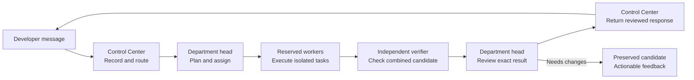

# Control Center hierarchy

The user clarified this product's interaction contract on 12 September 2026: every request enters the Control Center; the user does not choose a department in the composer. The Control Center selects the appropriate department, that department's head delegates to available workers, the head reviews the result, and the Control Center returns the response in the same conversation. This is a desktop developer workspace.

## Responsibilities

| Component | Owns | Does not infer |
| --- | --- | --- |
| Control Center | User conversation, project context, bounded intent classification, recorded routing decision, final response | Worker availability from a model's memory; success from an optimistic worker reply |
| Department head | Task decomposition, assignments within the admitted roster, semantic review of the combined result | Access to an unreserved or out-of-project worker; permission to override failed checks |
| Worker | Bounded implementation in an isolated candidate, tool output and evidence | Authority to apply the result to the user's checkout |
| Coordinator code | Queue ordering, exact worker reservations, process ownership, stop/resume, durable transitions and latency measurements | An estimated completion percentage presented as measured fact |
| Independent verifier | Executable acceptance checks against the exact candidate | Semantic completeness merely because tests passed |

The displayed flow is Control Center → department head → workers → independent checks and head review → Control Center. The head reviews the combined candidate so changes from multiple workers are considered together. A recorded head decision and passing independent checks are both required before the new flow can return an approved result. A negative review preserves the candidate and its feedback; it must not become a green completion. Automatic semantic rework is a separate bounded repair mechanism, not an implicit endless retry.

## Routing and capacity

The composer retains project context because executing against an unknown repository is unsafe and ambiguous. Department selection is internal. Explicit saved project routing rules can take the deterministic fast path. Otherwise a single bounded classification call sees the registered departments, capabilities and project context. A department without eligible workers remains a legitimate routing target: the interface reports what is missing instead of silently sending the request to an unrelated team. Ambiguity, unsupported runtime configuration and timeout produce a recorded clarification or blocker.

Receipt is persisted before routing starts. Routing does not wait for an available worker or a free project lock. Submission IDs deduplicate repeat clicks and retries so one logical message cannot launch duplicate work. The route and its measured duration are durable records.

At admission the coordinator chooses a bounded available worker set, reserves that exact set before process spawn, and passes it with the workspace revision to the CLI. The CLI validates and freezes that subset before the head can plan. Inside a run, one named worker has at most one active task at a time. Reservations survive temporary inactivity, repair and fallback until the owned run process exits; a reserved worker is shown separately from one currently executing. Resume reacquires the original frozen roster. Unknown external process ownership is treated conservatively.

The existing per-project coordinator lock still permits one live run per project. Other projects may run concurrently within configured limits and containment requirements. A routed request can therefore wait for its project while showing the exact queue reason. Supporting simultaneous coordinators on one project would require a separate storage/ownership change; faster classification does not remove that lock safely.

## Feedback and latency

The UI acknowledges a recorded message immediately, then displays routing, assignment, execution, checks and head review as those records arrive. The Control Center's final response derives from the recorded head-reviewed result. Raw worker output and technical receipts remain available under execution details and Activity.

The interface reports elapsed time, actual assigned agents and completed-task counts. Token or cost usage is shown only when the runtime reports it with an identifiable scope; unavailable metrics say so. Task counts are not a prediction of the remaining duration. Classification is bounded, capacity selection is deterministic code, and runtime startup/model latency is measured separately from local queue admission.

## Basis and validation

This is the manager pattern: one agent retains the conversation while specialists perform bounded work. OpenAI's [agent orchestration guidance](https://openai.github.io/openai-agents-python/multi_agent/) distinguishes manager-owned conversation from handoffs and recommends code where deterministic speed and control matter. Anthropic's [March 2026 harness report](https://www.anthropic.com/engineering/harness-design-long-running-apps) supports separating the generator from an evaluator and defining testable criteria; it also shows that extra evaluation adds real cost and latency. These support the design decisions here, not a guarantee about this implementation's performance.

The [initial UI evidence](evidence/harness-ui-2026-09-12/README.md) predates automatic routing and head review. The [new hierarchy evidence](evidence/control-center-2026-09-12/README.md) records a browser-submitted, automatically routed Codex task with one reserved worker, independent checks, actual head approval, and a final Control Center response. It also records measured routing latency and the current implementation limits. No further mobile proof is required by the user.
