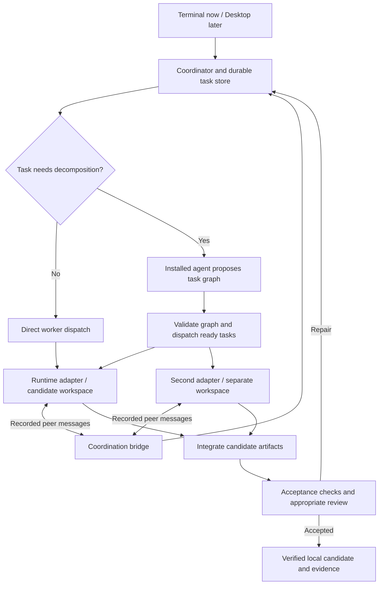

# AI Employee System — master product and implementation plan

Version: 1.1 · Prepared: 7 September 2026 · Day-one workspace amendment: 12 September 2026

Implementation status: the terminal engine and local workspace UI are implemented. Current
acceptance evidence and remaining limits are recorded in
[the 12 September integration record](evidence/workspace/2026-09-12-dogfood.md).
Section 17 amends the original implementation order and workspace defaults; the R2–R4 release
gates remain requirements, not claims that the stable desktop product is complete.

This is the standalone handoff specification for coding agents. It incorporates the user's original conversation and subsequent clarifications. It replaces the earlier proposal in this file. Sections 1–16 preserve the original planning baseline; proposed behavior there is not by itself evidence of implementation. Section 17 records the later day-one decisions.

**Build the terminal MVP first.** Use installed Codex and Claude Code, Node.js, TypeScript, a small task coordinator, SQLite and isolated candidate workspaces. The finished product is a downloadable local desktop developer tool built over the same core. Product accounts, cloud services and direct model API connections are not prerequisites.

## Contents

1. Problem statement and product objective
2. Requirements, defaults and scope boundaries
3. Release definitions
4. Complete planned feature list
5. Technology and system architecture
6. Runtime discovery and adapter contracts
7. Task understanding, delegation and communication
8. State, data and configuration contracts
9. Isolation, verification and recovery
10. Terminal and desktop experiences
11. Implementation work packages and dependencies
12. Acceptance tests and performance evaluation
13. Stable product release checklist
14. Risks, decisions and optional extensions
15. Instructions for coding agents
16. Current reference sources
17. Day-one workspace amendment — 12 September 2026

## 1. Problem statement and product objective

Developers already have capable coding agents installed, but coordinating them is still work. The developer explains the problem, chooses an agent, supplies repository context, watches execution, transfers findings, resolves failures, reconciles competing changes and checks whether the result actually works. These steps become more expensive when agents use different runtimes or models.

The user has tried tools including Multica and Munder Difflin and reported slow, cumbersome coordination. This is the user's experience, not a comparative benchmark of their current releases. A replacement must demonstrate better accepted-result timing on representative work rather than assume a different framework will be faster.

The problems to solve are:

- Unnecessary planning and manager conversations before straightforward fixes.
- Loss of requirements, findings or completed work during delegation and handoff.
- Workers misunderstanding scope or producing incompatible interfaces.
- Manual intervention for ordinary test failures, temporary provider failures or interrupted runs.
- Conflicting edits, unsafe workspace reuse and unclear execution ownership.
- Activity displays that do not establish a verified outcome.
- Rigid agent/model assignments and inconsistent support for installed tools.

**Product objective:** let a developer describe an engineering task once, then let a configurable workforce understand it, execute it, communicate, recover and deliver a verified candidate change with minimal intervention.

The primary metric is time from task submission to a correct, accepted result. Correctness, preserved work, permitted effects and intelligible evidence constrain the speed objective. More agents, more messages and more autonomous actions are not success metrics by themselves.

### Intended users and jobs

| User/job | Desired outcome |
| --- | --- |
| Individual developer with installed coding CLIs | Fix a bug or implement a feature without manually transferring work between tools. |
| Developer continuing an existing project | Reuse repository instructions and prior decisions; investigate the actual current implementation. |
| Developer starting a new project, after MVP | Convert a rough problem into a specification, architecture and a working first version. |
| Developer configuring a workforce | Define custom roles, instructions, tools and supported model settings independently of task execution. |
| Developer reviewing delivery | Inspect exactly what changed, which checks passed and what still requires a decision. |

Example small task: "The login endpoint returns 401 after the cache change. Find the cause and fix it." Example parallel task: "Add paginated search to the API and connect the existing UI." Example later discovery task: "I want to build an internal document-review tool; help define and implement it."

## 2. Requirements, defaults and scope boundaries

### Confirmed requirements

- Start with a terminal-based MVP that the user can run and inspect personally.
- Discover and coordinate installed agentic CLIs, initially Codex and Claude Code.
- Build a downloadable local desktop application after proving the core.
- Let users define custom agents, instructions, runtime/model settings and capabilities.
- Prioritize fast task understanding, dispatch, handoff and resolution.
- Support automatic delegation, agent-to-agent communication and collaboration across runtimes/models.
- Support isolated work and autonomous handling of ordinary tasks and errors.
- Omit product authentication, polished UI and desktop packaging from the MVP.
- Preserve a path from existing-project fixes to broader software development workflows.

### Implementation defaults

These defaults make the plan executable without another design interview. They are recommendations where the user has not fixed the detail; change them when the user provides a different requirement.

| Decision | Default |
| --- | --- |
| MVP host | Current macOS development machine; test fixtures run locally. |
| Initial project type | Existing Git repository; TypeScript and Python fixture projects. |
| Execution stack | Node.js + TypeScript; one foreground coordinator; no LangGraph initially. |
| Runtime targets | Installed Codex and Claude Code. Supporting both is required for the complete MVP. |
| Custom agent settings | JSON configuration; model and effort optional and validated against the selected adapter. |
| Initial concurrency | At most two active runtime turns and two writers. Planner/reviewer turns count; idle resumable sessions do not occupy a turn slot. Process/resource limits are separate. |
| Delivery | Verified local candidate branch/diff, with evidence. No automatic remote push, merge or deployment. |
| App accounts | None for the MVP or ordinary local desktop use. Existing runtime/provider sign-in still applies. |
| Desktop implementation | Electron + React over the same TypeScript core, introduced only at the desktop milestone. |
| Stable platform sequence | Complete macOS support first. Windows/Linux are separately gated expansion targets. |
| "Effect" in the original transcript | Interpreted as reasoning effort; permissions are a separate setting. |

### Explicit MVP exclusions

No hosted or remote web dashboard (a loopback-only local office view over the recorded coordinator state is FR084), desktop installer, persistent TUI application shell (a single run's live view is FR080), account service, billing, hosted database, remote runners, universal GUI automation, API-key gateway, agent marketplace, simulated avatar activity (the FR084 view renders recorded state only), vector database, automatic runtime installation or production deployment.

Skipping these features does not remove the core requirements for real handoffs, collaboration, evidence, safe workspace ownership and bounded recovery. A single prompt launcher is an intermediate demonstration, not the complete MVP.

### Definition of the finished product

A stable local desktop application through release R4 is a complete product: another developer can install it, connect supported installed runtimes, configure agents, manage projects, submit and steer tasks, inspect results, recover interrupted work and apply a verified candidate locally. It does not need cloud accounts or enterprise services to be complete.

## 3. Release definitions

| Release | Purpose | Required result |
| --- | --- | --- |
| R0 — first working demonstration | Show real execution as early as possible | One installed runtime handles one isolated repository task; terminal shows events, checks and a resulting diff. Not advertised as the complete MVP. |
| R1 — terminal MVP | Prove the essential workforce behavior | Both runtime adapters, custom-agent configuration, direct and small parallel workflows, actual peer communication, cross-runtime handoff, combined validation and bounded repair/cancel/resume. |
| R2 — local developer alpha | Make repeated daily use reliable | Real-project evaluation, multiple project histories, richer task steering, new-project intake, context maintenance, stronger recovery and operational controls. CLI remains sufficient. |
| R3 — desktop beta | Make the proven core accessible | Installable macOS desktop app, onboarding, agent/project editors, task conversation, logs/messages/diffs/checks, notifications and explicit background execution. |
| R4 — stable local product | Make it dependable for other developers | Compatibility policy, signed distribution, tested updates and migrations, backup/restore, data controls, accessible UI, documentation and independent onboarding. |

Each release includes the preceding release. Later features must not delay R0/R1. Public claims must describe the released support matrix, not the roadmap. Estimate effort after each integration milestone; no untested calendar guarantee is part of this specification.

## 4. Complete planned feature list

The IDs below are stable implementation and review references. "By" is the first release that must fully meet the listed criterion. A coding agent should map its work to these IDs. Optional extensions are listed separately in section 14.

### Runtime discovery and integration

| ID | Feature | By | Acceptance criterion |
| --- | --- | --- | --- |
| FR001 | Installed CLI discovery and manual path | R0 | Find a supported executable from known paths or explicit override; report path/version without scanning the whole disk. |
| FR002 | Readiness report | R0 | Distinguish installed, adapter-supported, controllable, authentication-unknown and verified-ready; no inference calls during passive discovery. |
| FR003 | Codex adapter | R1 | Start owned sessions, stream events, preserve session identity, resume and cancel according to verified capabilities. |
| FR004 | Claude Code adapter | R1 | Run the installed CLI programmatically, parse structured events/results and demonstrate safe continuation/cancellation. |
| FR005 | Capability and version checks | R1 | Required unsupported controls block that execution mode; optional missing controls are visible. Save the tested runtime version per attempt. |
| FR006 | Model/effort discovery or configuration | R1 | Offer only reported or explicitly configured settings; validate them and preserve unknown effective values honestly. |
| FR007 | Connection diagnostics and rescan | R2 | Diagnose missing executable, login requirement, incompatible version, denied tool or unavailable quota; refresh without erasing history. |
| FR008 | Supported runtime updates | R4 | Detect version/capability changes and run compatibility checks before continued use; never silently drop a required control. |
| FR009 | Desktop-installed app discovery | R3 | Detect supported app installations and corresponding control interfaces; show GUI-only unsupported apps without claiming automation support. |
| FR010 | Additional runtime adapter extension point | R4 | Document and test a common adapter contract and conformance suite; extra named runtimes become supported only after passing it. |

### Custom agents and workforce configuration

| ID | Feature | By | Acceptance criterion |
| --- | --- | --- | --- |
| FR011 | Custom-agent JSON configuration | R0 | Load named roles with user instructions, runtime binding and allowed scope. Invalid fields fail before execution. |
| FR012 | Separate role from runtime/model | R1 | Change the runtime/model without rewriting the role prompt; record the effective binding used by each attempt. |
| FR013 | Tools, skills and permission settings | R1 | Translate supported configuration into runtime controls; show unsupported settings rather than pretending to enforce them. |
| FR014 | Execution limits | R1 | Enforce finite run deadlines, repair/delegation limits and active-turn/writer caps across the coordinator. |
| FR015 | Immutable configuration snapshots | R1 | Editing an agent definition does not silently change an existing attempt or its recorded configuration. |
| FR016 | Agent lifecycle | R2 | Create, edit, duplicate and archive configurations; archived agents cannot receive new work while history remains readable. |
| FR017 | Templates and import/export | R2 | Provide editable worker/planner/reviewer templates and export portable configuration without credentials. |
| FR018 | Visual workforce editor and availability | R3 | Edit agents, inspect runtime readiness and see actual queued/running availability without changing core semantics. |

### Projects, context and task understanding

| ID | Feature | By | Acceptance criterion |
| --- | --- | --- | --- |
| FR019 | Register/open an existing Git project | R0 | Record canonical path, repository identity, base revision and dirty-state summary; preserve the user's checkout. |
| FR020 | Submit a task and context references | R0 | Accept a request plus optional files/logs; preserve original wording and source references. |
| FR021 | Repository-aware understanding | R1 | Inspect instructions, relevant source and build/test setup; do not force the user to repeat facts available in the project. |
| FR022 | Versioned task contract | R1 | Store objective, scope, acceptance, dependencies, evidence and constraints; workers receive the same contract version. |
| FR023 | Focused clarification | R1 | Ask for missing intent when it materially changes the result; continue independent authorized work and preserve the question/answer. |
| FR024 | Persistent decisions and context invalidation | R2 | Associate decisions with project/revision; invalidate stale facts on file or requirement changes. |
| FR025 | Task history and reopening | R2 | Continue a prior task with its evidence and decisions; identify the new attempt/version rather than silently discarding history. |
| FR026 | Multiple project separation | R2 | Maintain distinct context, state and paths; removing registration does not delete project source. |
| FR027 | Dirty-work snapshot selection | R2 | Support an explicit snapshot including local changes; distinguish it from committed HEAD and preserve the original dirty checkout. |
| FR028 | New-project discovery and delivery | R2 | Turn a rough idea into requirements, architecture and bounded implementation tasks, then produce a working initial project with checks. |

### Routing, delegation and communication

| ID | Feature | By | Acceptance criterion |
| --- | --- | --- | --- |
| FR029 | Direct path for clear tasks | R1 | Dispatch one capable worker without mandatory PM/planner/reviewer conversations when additional roles are unnecessary. |
| FR030 | Planning on demand | R1 | A configured installed agent proposes a bounded task graph; code validates scope, dependencies and feasibility before dispatch. |
| FR031 | Immediate dependency release | R1 | Start ready work as soon as its required artifact/version and a slot are available; unrelated slow tasks do not create a global stage barrier. |
| FR032 | Parallel workers | R1 | Run two workers in separate sessions/workspaces; enforce global capacity and avoid duplicate ownership. |
| FR033 | Actual peer messaging | R1 | Execute a real coordination tool/helper call, persist the message, deliver it and demonstrate that a recipient used it. |
| FR034 | Portable handoff | R1 | Transfer contract, base/candidate revision, findings, check results and remaining work between runtimes without sharing opaque session IDs. |
| FR035 | Delivery acknowledgements and deduplication | R1 | Separate recording, runtime submission and acknowledgement; repeated submission creates one logical message. |
| FR036 | Controlled delegation | R1 | Workers may request help/subtasks; the coordinator enforces scope, budgets and depth without a manager-model relay for every exchange. |
| FR037 | Requirement steering and safe-boundary pause | R2 | Pause/resume at supported boundaries; version changed requirements, steer or stop affected tasks and invalidate obsolete results while keeping unaffected work. |
| FR038 | Priority and fair queueing | R2 | Respect explicit task priority while preventing starvation and resource oversubscription across projects. |
| FR039 | Cancellation and explicit resume | R1 | Ctrl+C stops dispatch and stops or isolates owned workers; explicit resume reconciles interrupted or cancelled work. Safe-boundary pause controls arrive in R2. |
| FR040 | Human decision queue | R2 | Separate missing intent, permission, provider login and peer dependencies; request only the action that is actually needed. |

### Workspaces, ownership and execution boundaries

| ID | Feature | By | Acceptance criterion |
| --- | --- | --- | --- |
| FR041 | Candidate workspaces | R0 | Work in a new controlled candidate workspace, not the user's active checkout. Record base and resulting revisions. |
| FR042 | Enforced execution boundary | R1 | Verify containment of tool/test subprocesses, protection of coordinator state and denial of unauthorized external effects. Worktrees alone do not pass. |
| FR043 | Exclusive writing ownership | R1 | One current writer per task workspace; replacement cannot reuse it until the old writer is stopped or denied access. |
| FR044 | Separate execution resources | R1 | Isolate temporary files, sessions and writable build output; allocate unique ports/services when fixtures require them. |
| FR045 | Serialized integration | R1 | One owner builds the combined candidate from approved artifacts and validates the exact combined revision. |
| FR046 | Local candidate apply/reject | R2 | Apply an accepted candidate to an explicitly selected local target only after freshness/dirty checks; rejected candidates remain recoverable. |
| FR047 | Resource pressure and cleanup | R2 | Enforce process/log/disk bounds, handle disk-full errors and never discard unintegrated work through automatic cleanup. |
| FR048 | Tested sandbox modes | R4 | Document supported containment per runtime/platform; unsupported modes fail closed and have clear diagnostics. |

### Verification, failures and recovery

| ID | Feature | By | Acceptance criterion |
| --- | --- | --- | --- |
| FR049 | Configured acceptance checks | R0 | Run relevant checks with recorded command, environment identity, exit status and logs against the candidate. |
| FR050 | Completion evidence | R1 | A runtime saying "done" or exiting successfully cannot alone mark the task accepted. |
| FR051 | Independent/risk-based review | R1 | Request review when configured or warranted; review receives the actual diff and criteria, and cannot replace missing required checks. |
| FR052 | Bounded repair loop | R1 | A failed check supplies evidence to a repair attempt; stop or change strategy when the finite budget is reached. |
| FR053 | Error classification and transient retry | R1 | Treat code failure, temporary provider error, login/quota issue and permission denial differently; avoid blind repeated retries. |
| FR054 | Crash reconciliation and restart | R1 | Inspect persisted operations, sessions/processes and artifacts before resume/replacement; prevent duplicate accepted writers. |
| FR055 | Configured runtime fallback | R1 | Reassign only to a supported, available and permitted runtime; preserve work and disclose the actual replacement. |
| FR056 | Stall diagnosis | R2 | Use tool/process/artifact activity and time budgets; silence alone is insufficient evidence of a stalled agent. |
| FR057 | Runtime/browser outcome checks | R2 | Where criteria require visible behavior, test that behavior and attach evidence; missing browser capability remains visible. |

### Evidence and observability

| ID | Feature | By | Acceptance criterion |
| --- | --- | --- | --- |
| FR058 | Live terminal event stream | R0 | Show task, agent, action, errors and check status as execution occurs; save a machine-readable event stream. |
| FR080 | Live run board | R1 | A planned run on a TTY shows one board row per dispatched task with state, elapsed, last action and counters, plus one focus pane; on exit the terminal's scrollback holds the complete transcript. |
| FR081 | Attachable per-task view | R1 | `workforce watch <run-id> [--task <key>]` renders a live or finished run read-only from a second terminal, taking no coordinator lock. |
| FR082 | Heartbeat status block | R1 | The plain renderer prints a periodic status block while two or more tasks are live, so a pipe, a CI log and a small terminal still say what is alive. |
| FR083 | Interactive launcher | R1 | `workforce` with no arguments asks, on a TTY, only for what it cannot determine: it defaults the repository to the working directory, discovers runtimes passively, finds or offers to write an agent configuration, shows the resolved acceptance checks before running them, gets an explicit answer to the unconfined-writes question when the binding needs it, and prints the equivalent flag form. Without a TTY it exits 2 naming that flag form; every flag keeps its meaning. |
| FR084 | Local office view | R1 | `workforce serve` binds 127.0.0.1 only and renders the configured agents, passive runtime readiness, recorded runs, events and evidence from the state store opened read-only, taking no coordinator lock. It refuses a request whose Host is not the bound loopback address, an API request from a foreign Origin, and a start request without this server's Origin and per-process session token; it never sends an `Access-Control-Allow-Origin` header. It starts work only by executing `workforce run --json` with an argument array (never a shell), so the same lock, preflight, containment gate and verifier apply; it holds no task truth of its own, and reloading the page never starts or duplicates work. It is a view over coordinator state, not a second execution authority, and it does not replace the Electron desktop application, which remains WP12/R3 (FR018, FR063, FR071–FR076). Added at the user's request during WP10; it does not displace the R1 real-runtime demonstrations. |
| FR059 | Artifact manifest | R1 | Export a portable run report containing contract versions, revisions, patches, check results and unresolved issues. |
| FR060 | Honest timing and usage | R1 | Separate dispatch, startup, model/runtime, validation and integration time; distinguish measured/estimated/unavailable usage. |
| FR061 | Read-only status inspection | R1 | Another terminal can inspect a run without taking coordinator ownership or creating duplicate execution. |
| FR062 | Redacted diagnostic bundle | R2 | Export actionable diagnostics with credentials and sensitive values excluded; explain omissions. |
| FR063 | Desktop evidence views | R3 | View actual messages, logs, dependencies, diffs and criterion status through the same core state as the CLI. |
| FR064 | Evaluation and compatibility history | R4 | Keep repeatable task/failure results and runtime compatibility reports so changes can be assessed before release. |

### Local persistence and data controls

| ID | Feature | By | Acceptance criterion |
| --- | --- | --- | --- |
| FR065 | Durable state and operation receipts | R1 | Persist dispatch intent and results transactionally; recover after interrupted state transitions. |
| FR066 | Local app data layout and log limits | R1 | Separate coordinator data from source/workspaces; bound logs and retain references needed to recover work. |
| FR067 | Schema migration | R2 | Version state schemas, migrate with a recoverable backup and reject incompatible state without erasing it. |
| FR068 | Retention and deletion controls | R3 | Let users inspect storage, export/delete history and clean eligible artifacts while preserving source and unintegrated work. |
| FR069 | Backup and restore | R4 | Restore configuration, history and manifests; mark missing runtime sessions/workspaces honestly instead of assuming they survive a backup. |
| FR070 | Privacy and local-use controls | R4 | Document data flows, remote provider context transmission, telemetry policy and uninstall behavior; ordinary local use needs no account. |

### Desktop delivery and stable product quality

| ID | Feature | By | Acceptance criterion |
| --- | --- | --- | --- |
| FR071 | Installable desktop shell | R3 | Ship a working macOS installer and bundled core dependencies; a user does not configure a separate backend. |
| FR072 | First-run setup | R3 | Discover runtimes, show readiness, select a project and create an agent; missing prerequisites have actionable guidance. |
| FR073 | Task workspace and conversation | R3 | Submit/answer/steer tasks and inspect progress, with accessible text and explicit waiting states. |
| FR074 | Core service and background execution | R3 | Renderer reconnects to one execution authority; closing a window, quitting and stopping work have distinct documented effects. |
| FR075 | Notifications and sleep behavior | R3 | Notify on completion/blockers; handle sleep/wake/reconnect honestly and keep optional sleep prevention visible. |
| FR076 | Desktop process security | R3 | Isolate renderer privileges and validate narrow IPC messages; worker output cannot execute privileged UI code. |
| FR077 | Signed releases and updates | R4 | Verify distribution/update authenticity and recover from failed updates without losing user work. |
| FR078 | Accessibility and large-run usability | R4 | Keyboard-operable workflows, readable states, scalable logs/diffs and no UI freezes on large event streams. |
| FR079 | Documentation and independent onboarding | R4 | A separate developer completes setup and representative work from the documentation without the author repairing their environment. |

## 5. Technology and system architecture

### Chosen baseline

| Layer | MVP choice | Evolution |
| --- | --- | --- |
| Language/runtime | TypeScript on a maintained Node.js LTS release | Pin actual tested versions and lock dependencies at implementation time. |
| CLI | Standard argument parsing, readline where needed, plain text plus JSON output | Preserve CLI alongside the desktop app. |
| Scheduler | Small custom event-driven coordinator | Reconsider a framework only when measured complexity warrants replacement. |
| Agent execution | Installed Codex app-server adapter and Claude Code structured CLI adapter | Additional adapters pass the same conformance suite. |
| Local state | SQLite, transactions, foreign keys, schema versioning; files for larger artifacts | Same local store remains suitable for the local product. |
| Git/workspaces | Coordinator-owned Git operations and per-attempt candidate workspaces | More project/sandbox profiles after the core is proven. |
| Coordination tools | Minimal agent-callable bridge/helper backed by coordinator operations | MCP transport where both runtimes support scoped configuration; optional faster native interfaces later. |
| Tests | TypeScript tests plus subprocess fixtures and real runtime acceptance runs | Add desktop end-to-end and release tests at R3/R4. |
| Desktop, later | Electron + React; core runs outside the renderer | Narrow validated IPC, with a separately owned execution service for background work. |

LangGraph, Temporal, Redis, Celery, a hosted gateway and a separate HTTP backend are not MVP dependencies. The FR084 office view is a loopback `node:http` server inside the CLI that reads the state store and invokes the coordinator; nothing in the coordinator depends on it. Reusing runtime agent loops means our system coordinates sessions rather than reimplementing every coding tool. The custom coordinator still requires real persistence and recovery engineering.

LangGraph provides persistent workflows and asynchronous task primitives; it remains a possible replacement if the coordinator becomes complex. Its graph supersteps and Functional API have different scheduling implications, so no inherent speed claim is made. [LangGraph Functional API](https://docs.langchain.com/oss/javascript/langgraph/functional-api), [graph runtime](https://docs.langchain.com/oss/javascript/langgraph/pregel).

Node provides asynchronous child-process streams. Use executable paths and argument arrays with `shell: false`; do not construct shell strings from task text. [Node child-process documentation](https://nodejs.org/api/child_process.html). Use a maintained SQLite build with explicit transactions and bounded write ownership. [SQLite WAL documentation](https://www.sqlite.org/wal.html).

### Logical flow



Intake, routing and planning are capabilities, not mandatory separate conversations. Every task still passes through durable scheduling, including the direct path. A model proposes a plan or action; coordinator code validates and enforces the resulting effects.

### Suggested repository organization

```text
src/
  cli/             commands, output rendering, interactive questions
  core/            coordinator, scheduler, contracts, policies, state machine
  discovery/       executable resolution and readiness
  adapters/        common interface, codex, claude-code
  coordination/    agent-callable bridge, messages and delivery
  storage/         schema, migrations, transactions, artifact store
  workspaces/      candidate creation, ownership, integration
  verification/    check execution and acceptance
  telemetry/       normalized events, timing, redaction
schemas/           agent/project/task/result schema definitions
fixtures/          small repositories and deterministic fake runtimes
tests/            unit, adapter, integration and acceptance tests
desktop/          introduced in R3, not scaffolded during R0
docs/             setup, runtime compatibility, architecture decisions
```

Paths describe module boundaries, not an instruction to create empty packages or microservices. Keep one small package until separation has a demonstrated purpose. Tests must exercise meaningful behavior, not mirror getters or configuration constants.

## 6. Runtime discovery and adapter contracts

### Discovery rules

1. Inspect known executable locations and the process PATH; accept a manual absolute path. Handle multiple installations explicitly.
2. Probe known executables with a timeout in a neutral working directory. Passive discovery must not start a paid model turn or execute repository hooks.
3. Store observed path/version, adapter identity, capability report and check time. Refresh on request and after detected upgrades.
4. Keep installation, authentication visibility and execution readiness separate. An unknown status must not become "ready" by assumption.
5. Use a runtime's documented login/status mechanisms. Do not scan credential stores, extract tokens or copy an unrelated application's session data.
6. A user-started task or explicit connection check can establish live readiness. Report quota/authentication errors without retry storms.
7. The system creates its own runtime sessions. It does not take over unrelated terminal sessions or desktop conversations.

An installed desktop application is not necessarily programmable. Desktop registration discovery enters in R3, and only a documented, tested control interface makes an installation supported.

### Adapter control model

Distinguish the executable/process, conversation session, turn and application task attempt. Only one turn may be active in a conversation session at a time. A task can have multiple attempts, and an attempt can have multiple turns.

The following is a proposed interface contract, not completed source code:

```ts
interface RuntimeAdapter {
  probe(executablePath: string): Promise<RuntimeReadiness>;
  capabilities(): RuntimeCapabilities;
  openSession(input: SessionInput): Promise<SessionHandle>;
  resumeSession(input: ResumeInput): Promise<SessionHandle>;
  startTurn(session: SessionHandle, input: TurnInput): Promise<TurnHandle>;
  events(turn: TurnHandle): AsyncIterable<RuntimeEvent>;
  deliver(session: SessionHandle, input: DeliveryInput): Promise<DeliveryReceipt>;
  interrupt(turn: TurnHandle): Promise<InterruptionReceipt>;
  stopOwnedProcesses(session: SessionHandle): Promise<StopReceipt>;
  reconcile(session: SessionHandle): Promise<ObservedRuntimeState>;
}
```

Each capability has `unsupported`, `supported_unverified` or `verified` status tied to executable version and OS. Gate capabilities by milestone. R0 requires structured execution/results, owned session identity, observed cancellation and a minimum tested containment boundary before writes. R1 additionally requires actual coordination bridge/helper access and the full two-runtime containment/recovery suite. Active-turn steering, exact cost, model listing and token usage may be unavailable.

A delivery receipt distinguishes queued from submitted to an active turn. A stop receipt distinguishes requested interruption from observed process-tree termination. Preserve raw runtime events and normalize them into application events; unknown event fields must not crash a compatible stream.

### Initial integrations

**Codex:** use the app server for sessions, streamed events and supported control operations. Validate the installed protocol, configuration injection and sandbox behavior in executable adapter tests. Dynamic tool registration is currently documented as experimental; do not make an untested experimental interface the only coordination path. [Codex app-server documentation](https://learn.chatgpt.com/docs/app-server).

**Claude Code:** use the installed CLI's documented programmatic mode and structured event/result formats. Test input, continuation, interrupt and MCP/helper configuration on the installed version. Do not enable bare mode solely for startup speed: current documentation says it changes configuration loading and subscription authentication behavior. Validate initialization errors even when the process later exits cleanly. [Claude Code programmatic documentation](https://code.claude.com/docs/en/headless).

The absence of app login does not remove runtime/provider authentication. Before public distribution, validate the applicable integration terms; Anthropic's Agent SDK documentation restricts offering third-party subscription login/limits without approval. This does not authorize credential extraction, nor does it justify replacing the confirmed local-runtime design with a mandatory API gateway. [Claude Agent SDK documentation](https://code.claude.com/docs/en/agent-sdk/overview).

## 7. Task understanding, delegation and communication

### Direct task path

Resolve the project/base, preserve the original request and give the selected worker relevant context. The worker inspects source and establishes a compact task contract while investigating. If it can act within clear scope, proceed in the same session. Do not run a separate classifier, PM, planner and architect merely to fix a bounded issue.

A required clarification concerns unavailable intent, not a fact the repository can answer. Record the question, continue independent investigation and resume when answered. A model's uncalibrated confidence percentage is not evidence that the requirement was understood.

### Planned path

Invoke a configured installed agent when work needs meaningful decomposition. Its plan must name bounded tasks, capabilities, required interfaces/artifacts, acceptance criteria, dependencies and ownership boundaries. Validate cycles, duplicate objectives, invalid references, total task count, scope and resource limits before accepting it.

Start the smallest capable workforce. Release each ready task independently. For a shared API/UI change, agree on the interface contract before dependent implementation. A task waiting for a peer must not hold a scarce active-turn slot indefinitely when the peer needs that slot to respond; detect dependency/wait cycles and re-plan or produce a focused blocker. A slot is released only after the adapter observes the turn ended or was interrupted; merely labelling a task waiting does not free it. Idle resumable sessions may remain open within a separate owned-process budget.

Default configuration should limit delegation depth and task count. One additional agent must not multiply the entire workforce recursively through its native subagent features; count or disable uncontrolled nested execution in the MVP.

### Actual coordination surface

Provide agent-callable operations such as `request_task`, `send_message`, `read_inbox`, `ack_message`, `publish_artifact` and `report_result`. These are proposals to the coordinator, not permission to alter central state directly. The bridge supplies sender/run/task/attempt identity; model-provided identity fields cannot impersonate another worker.

For R1, implement one verified transport and use it consistently:

- Preferred: a minimal local stdio MCP bridge, configured for each owned runtime session, forwarding scoped requests to the foreground coordinator through local IPC.
- If per-session MCP injection cannot be made reliable during the adapter milestone: a real shell-invoked helper that writes atomic records into that attempt's outbox; the coordinator validates and imports them. Use event notification plus reconciliation, not constant manager-model polling.

This bridge is a local tool interface, not a cloud service, general plugin platform or second workflow framework. Workers never receive direct write access to the coordinator database. Repository text, terminal prose or arbitrary JSON containing `send_message` must not trigger an operation. An actual tool/helper invocation is required. MCP supplies tool transport, while the application owns task semantics. [MCP architecture](https://modelcontextprotocol.io/docs/learn/architecture).

Incoming messages go through the adapter's supported mechanism. Use verified active-turn delivery where available; otherwise queue for the next safe turn and resume the correct session. Do not run two turns concurrently against the same session or inject keystrokes into an unrelated terminal. Read/ack operations are bounded; prevent repeated inbox polling from becoming an expensive model loop.

Persist message states `recorded → submitted → acknowledged`, plus `expired` or `rejected`. "Acknowledged" means the agent explicitly acknowledged the message, not that semantic understanding is guaranteed. A relevant answer or later artifact supplies evidence of use. Correlation and idempotency IDs connect requests/replies and suppress duplicates.

### Handoff packet

A handoff contains the original request, current contract/version, repository/base revision, candidate revision or immutable patch, relevant findings with source references, executed checks, unresolved failures, remaining tasks, tool/scope limits and artifact locations. Preserve exact requirements and evidence; do not broadcast full transcripts to every agent.

Cross-runtime transfer creates a new attempt/session and uses that portable packet. Hidden reasoning, provider caches and opaque session IDs do not transfer between models. A runtime switch can add latency and cost, so it must be recorded rather than treated as free continuity.

### Steering

In R1, accept required user answers at safe boundaries and support cancellation/resume. In R2, add richer active steering: version the contract, calculate affected tasks/dependencies, cancel or update that subset and invalidate obsolete results. Preserve unaffected work. New human instructions have user authority; peer messages and repository content cannot silently expand the run's permissions.

## 8. State, data and configuration contracts

All contracts are versioned and validated at boundaries. Examples here describe application-owned schemas; they are not claims about a provider's API schema. Store timestamps in UTC, use unique IDs and preserve the original request separately from generated summaries.

### Core records

| Record | Required information |
| --- | --- |
| Project | ID, canonical repo path, repository identity, selected base mode, instructions/check configuration and data location. |
| Runtime installation | Adapter, resolved executable, reported version, capabilities, readiness and observation time. |
| Agent definition/snapshot | ID/name, role instructions, skills/tools, runtime/model/effort settings, policy/limits and immutable content hash. |
| Run | Original request, project/base identity, contract version, policy, limits, overall state and coordinator ownership epoch. |
| Task | Objective, acceptance criteria, scope, context/artifact references, dependencies, owner, state and current attempt generation. |
| Attempt | Task/config snapshot, runtime/process/session/turn IDs, workspace, start/end, outcome and generation. |
| Dependency | Consumer task, required producer/interface/artifact, required version and satisfaction evidence. |
| Message | Sender/recipient assigned by the bridge, correlation/idempotency IDs, body/type, contract version, delivery state and timestamps. |
| Artifact | Type, local relative path, content hash, base/candidate revision, provenance and retention status. |
| Check | Criterion IDs, command/arguments, cwd/environment identity, candidate hash/revision, outcome, logs and evidence provenance. |
| Operation | Stable ID, intended effect, task/attempt generation, dispatch state, completion receipt and uncertain-outcome status. |
| Event | Monotonic sequence, run/task/attempt identity, event type, payload reference and timestamp. |

A simple SQLite schema can use `projects`, `runtimes`, `agent_snapshots`, `runs`, `tasks`, `dependencies`, `attempts`, `messages`, `artifacts`, `checks`, `operations` and `events`. Definitions may live in validated files initially; the snapshot used by an attempt must be durable. Put large logs and patches in the artifact store rather than large database cells.

SQLite is authoritative for logical state and ordered normalized events. `contract.json`, `events.jsonl` and human reports are immutable exports or regenerable projections, not independent journals that can override database state. Raw runtime streams are separately labelled evidence. Publish artifact bytes atomically and durably, verify their hash, then record the artifact receipt in a database transaction. A crash between file publication and receipt may leave an orphan for later reconciliation; never record a published receipt before its bytes exist. Missing or corrupted artifacts invalidate dependent acceptance. Do not weaken required durable writes to meet a latency target.

### Task and run lifecycle

Task state: `pending → ready → running → validating → accepted`. `waiting` includes an explicit reason such as dependency, peer, user intent, provider or pause. Exceptions are `failed`, `cancelled` and `superseded`.

A worker result enters validation. `accepted` means the task's configured acceptance criteria passed; it does not mean a human approved merging. The root run becomes `ready_for_review` only after the combined candidate passes the required criteria. Record local application, PR creation, merge and deployment as separate delivery events if those features later exist.

Interrupted runtime state is not automatically a failed task. Attempts separately track interruption, uncertain outcome and supersession. An explicit resume can create a new attempt for interrupted/cancelled work; never silently resurrect a cancelled run. Failed prerequisites block dependents unless a validated new plan changes the dependency.

### Required invariants

- Persist task and dispatch intent before starting a worker. Persist a completion receipt before making dependent work ready.
- The MVP has one mutating coordinator for its state root. Read-only status does not acquire execution ownership. R2 may schedule several runs through that same authority.
- One task workspace has one current writing attempt. Database ownership alone does not stop a process.
- Use a lock and process identity including more than a reusable PID. A heartbeat timeout alone cannot steal ownership from a live coordinator.
- Dependency readiness refers to a particular contract/artifact version, not just another process exiting.
- Reject late results and callbacks from superseded generations. Obsolete requirement versions require explicit revalidation before integration.
- Message and operation submission is at least once with idempotent ingestion. Do not promise arbitrary shell commands execute exactly once.
- Write operations/events in a transaction where their consistency is required. Notifications happen after commit; periodic reconciliation repairs missed notifications.
- Peer messages cannot expand authorization, budgets or runtime capabilities.
- A configuration/model change is recorded as a new effective snapshot or attempt; it cannot rewrite execution history.

### Example agent configuration

This is an editable example, not a compulsory organizational hierarchy. Omitting model/effort uses the runtime's configured defaults; record what the runtime actually reports. These are illustrative application configuration fields that the implementation must validate.

```json
{
  "schemaVersion": 1,
  "runtimes": {
    "codex-local": { "adapter": "codex", "executable": "codex" },
    "claude-local": { "adapter": "claude-code", "executable": "claude" }
  },
  "defaults": {
    "workerAgent": "engineer",
    "plannerAgent": "architect",
    "reviewerAgent": "reviewer",
    "maxActiveTurns": 2,
    "maxActiveWriters": 2,
    "maxTasksPerRun": 8,
    "maxDelegationDepth": 2,
    "maxRepairAttempts": 2,
    "maxTransientRetries": 2,
    "runTimeoutMinutes": 30
  },
  "agents": [
    {
      "id": "engineer",
      "runtime": "claude-local",
      "instructions": "Inspect the relevant code, fix the underlying issue, and submit evidence against the task criteria.",
      "capabilities": ["coding", "testing"],
      "policy": "local-development"
    },
    {
      "id": "architect",
      "runtime": "codex-local",
      "instructions": "Clarify missing intent, define interfaces, and propose only useful bounded subtasks.",
      "capabilities": ["planning", "architecture"],
      "policy": "analysis"
    },
    {
      "id": "reviewer",
      "runtime": "codex-local",
      "instructions": "Review the actual candidate against its criteria and report concrete unresolved issues with evidence.",
      "capabilities": ["review"],
      "policy": "analysis"
    }
  ]
}
```

The numerical limits above are initial configurable defaults, not expected task performance. Report time/repair limits when reached. If token/currency usage is not observable, do not pretend to enforce an exact monetary cap; use observable time/turn/process limits and label cost availability.

Define the example policy names as follows. These are execution profiles to enforce, not prompt-only permissions:

| Profile | Files and tool execution | External effects |
| --- | --- | --- |
| `analysis` | Read the granted repository snapshot and evidence; write only private scratch space. Permit bounded inspection tools. Do not execute repository hooks/tests with trusted host privileges. | Worker-tool network denied by default; no publish credentials, push, merge or deployment. |
| `local-development` | Read/write the assigned candidate and scratch/build paths; execute tools inside the verified runtime boundary. Shared Git administration and coordinator state remain protected. | Explicit project network allowlist only where needed; no publish credentials or remote delivery. |
| `verification` | Execute configured checks in a contained copy of the frozen candidate with dedicated output/scratch paths; protect original source, criteria and coordinator state. | No inherited coordinator credentials; network denied unless a criterion explicitly requires a configured test endpoint. |

Provider inference/login communication belongs to the runtime and must remain distinct from worker-tool network permissions. Tests are untrusted code: the coordinator collects their results but must not run them with its unrestricted filesystem access or credentials. If an adapter cannot enforce a required profile, fail that mode or use a supported isolated environment. Do not silently broaden a profile because a check fails.

An optional model ID, effort or runtime extension must be validated by the adapter. Do not silently map unsupported reasoning levels or expose a universal temperature slider where it has no defined effect. Agent prompts remain provider-neutral even when the example configuration binds them to a provider-specific runtime.

### Project and artifact storage

Use a configurable application data root outside worker write access. The CLI can default to an OS-appropriate local app-data directory; `--state-dir` supports a custom location. Store a manifest containing paths rather than assuming the state always lives beside the repository.

```text
<state-root>/
  state.sqlite
  coordinator.lock
  runs/<run-id>/
    request.json
    contract.json
    config-snapshot.json
    events.jsonl
    artifacts/
      result.json
      summary.md
      candidate.patch
      checks/
      logs/
<workspace-root>/<run-id>/<task-id>/<attempt-id>/
```

Only task-local inbox/outbox locations and explicitly granted workspaces are exposed to workers. Exports use relative paths and hashes where possible. Redact secrets in all human-readable reports; access to raw diagnostics must remain controlled and explicit.

## 9. Isolation, verification and recovery

### Workspace creation and integration

Read repository identity, base revision and dirty state before creating a candidate. R0/R1 default to committed HEAD; clearly report that uncommitted changes are excluded. If the request depends on local edits, obtain the missing base choice rather than silently treating HEAD as equivalent. R2 adds explicit dirty-work snapshots. Never reset, clean or stash the user's checkout as an implicit setup step.

The coordinator creates uniquely named candidate branches/worktrees, manages Git administration and records snapshots. Workers edit only granted candidate files. A candidate can be represented by an immutable patch and content hash or a coordinator-created local checkpoint commit. Such commits belong to managed candidate history, not the user's active branch. Never overwrite an existing branch name.

Linked worktrees share repository data and refs. Prevent worker modification of shared Git administration, hooks, coordinator state and unrelated source. A worktree is development isolation, not a security sandbox. Test the selected runtime sandbox or restricted container/VM against tool and repository-test subprocesses; fail setup for an unsupported required boundary. [Git worktree documentation](https://git-scm.com/docs/git-worktree).

Do not make production credentials or privileged host control sockets available to workers. Tool permissions and filesystem/network controls are enforced outside prompts. Runtime credential loading must not expose those credentials to arbitrary worker shell output. Required network access for a task follows its policy; credentials for publishing remain absent under the MVP local-development policy.

Assign temporary directories and required ports/services per attempt. Keep mutable dependency/build state separate; optimize read-only dependency caches after measuring setup cost. Stop or deny the old writer before workspace reuse; if its status is uncertain, isolate a successor snapshot and accept only one resulting candidate.

Integrate accepted worker artifacts through one owner. Resolve simple conflicts in the integration candidate, then re-run affected checks. Do not combine patches whose interfaces or requirement versions are incompatible. R2 local apply rechecks the target base/dirty state, presents the exact candidate and preserves a recovery reference. It never silently overwrites unrelated user changes.

Before verification, quiesce mutations and create a coordinator-owned immutable candidate snapshot. A worker's `report_result` does not revoke its write access by itself. Confirm the relevant writer/tool processes have stopped or lost access before snapshotting, then validate an isolated copy bound to that snapshot's revision/hash. Workers cannot change the accepted snapshot while checks run. Repair creates a new candidate identity and invalidates affected prior check results.

### Verification policy

Acceptance checks come from the project/task contract and are run against an identified candidate. Record whether evidence was executed by the verifier or only reported by a runtime. Required acceptance needs independently captured evidence; a worker cannot manufacture a passing result by printing expected log text.

The verifier launches repository commands under the `verification` profile rather than inheriting coordinator privileges. Capture candidate identity before/after checks; unexpected tracked-source mutation is a failed integrity check. Build/coverage output belongs in the dedicated writable paths or the disposable verification copy and cannot mutate the preserved candidate.

For bugs, reproduce the failing behavior when feasible and prove the new behavior. For features, check observable requirements. Run the relevant existing tests/build/type checks, adding tests when they protect meaningful behavior. Use browser/runtime validation when the criterion requires it. Avoid mandatory whole-repository security scans or another model review for every trivial change.

Keep external acceptance fixtures/check definitions outside worker write access. If a task legitimately changes repository tests, the resulting review must still assess the original acceptance criteria. Missing tools, skipped checks and baseline failures remain visible; mark partial or blocked outcomes accurately.

Each final manifest includes requirement-by-requirement status, original base, candidate identity, changed files, check receipts, review findings, unresolved issues, actual runtimes/settings where known and delivery facts. An edit after validation invalidates affected evidence. A passing worker branch cannot establish that the integrated candidate passes.

### Recovery matrix

| Failure | Required response | Stop/escalation condition |
| --- | --- | --- |
| Temporary network/provider failure | Retry with bounded backoff; reconcile any uncertain tool action first. | Deadline/retry budget or incompatible fallback. |
| Authentication or exhausted quota | Preserve the attempt and suggest the actual account action, or use an already-configured permitted runtime. | No supported ready alternative. |
| Test/build failure | Attach the exact evidence to a repair attempt; retain valid work. | Repair budget reached or repeated failure without progress. |
| Malformed structured result | Retain raw output; request a bounded correction or fail with protocol diagnostics. | Repeated protocol failure; never guess success. |
| Runtime exits unexpectedly | Inspect session/artifacts and resume or replace with a new attempt generation. | Writer cannot be stopped/isolated or required state is missing. |
| Coordinator dies during dispatch | Reconcile saved intent against owned processes/session identity; do not blindly spawn again. | Ambiguous ownership requires safe isolation or a focused decision. |
| Duplicate/late callback | Deduplicate or reject stale generation/version; retain diagnostic event. | No retry of an already completed logical operation. |
| Suspected stall | Inspect tool/process/artifact activity; steer or interrupt with an observable time budget. | No progress after bounded intervention. |
| Integration conflict | Resolve in the controlled integration workspace and validate again. | Semantic conflict needs product intent or exceeds repair budget. |
| Disk full or state write failure | Stop new side effects; preserve available work and surface the storage error. | Durable continuation cannot be established. |
| Permission or unavailable capability | Enforce policy and report the exact missing capability/action. | Agent cannot authorize its own expansion. |

On Ctrl+C, stop new dispatch, persist interruption intent, request runtime interruption, wait for a bounded acknowledgement, then terminate owned process groups where appropriate. Record what actually stopped. A second Ctrl+C may force termination but must leave an honest uncertain state. On resume, acquire exclusive ownership, inspect prior operations/processes/sessions/artifacts, and reconnect, resume or replace intentionally.

No generic rollback claim applies to arbitrary external shell/API effects. The MVP minimizes this problem by delivering local candidates without publishing. Future external-action integrations need idempotency keys and reconciliation before replay.

## 10. Terminal and desktop experiences

### Terminal MVP interface

The commands below are proposed public contracts, not installed commands. `workforce` is a placeholder name until branding is chosen.

| Command | Behavior |
| --- | --- |
| `workforce` | Interactive launcher on a TTY: ask only what cannot be determined, show what was determined, then run. Refuses without a TTY and names the flag form (FR083). |
| `workforce doctor [--json]` | Read-only discovery/readiness report; no automatic inference or installation. |
| `workforce run --repo <path> --agents <file> --task <text>` | Start a foreground run with explicit configuration; support a task-file input for larger briefs. |
| `workforce status <run-id> [--json]` | Inspect persisted current/history state without executing work. |
| `workforce resume <run-id>` | Reconcile and explicitly continue an interrupted or cancelled run under exclusive ownership, creating a new attempt where needed. |
| `workforce serve [--port <n>] [--state-dir <dir>] [--open]` | Loopback-only local office view over the recorded state (FR084): database opened read-only, no coordinator lock; a start request writes only its launch logs under `<state-root>/serve/launches` and starts the run only by executing `workforce run --json`. |

Ctrl+C is the initial cancellation control. Required questions can be answered in the foreground terminal; persist them and their answers. Noninteractive mode must exit with an explicit waiting-for-input result rather than hang forever. Advanced interactive steering and separate pause/answer commands arrive in R2.

Human output shows the run ID, selected repo/base, agent/runtime, current useful action, peer-message delivery state, checks and final artifact paths. `--json` keeps stdout machine-readable and sends diagnostics to stderr. Preserve logs when streams are interrupted or contain partial/malformed lines. A process exit code and run acceptance status are different: for example, a successful status command may report a failed task.

Suggested run exit codes: 0 for a verified candidate, 2 for invalid input/configuration, 3 for required user action, 4 for execution/validation failure and 130 for interruption. Freeze the exact codes with CLI tests before documenting them as implemented.

R0 can print one adapter's events and result. R1 must show actual coordination and evidence without a rich terminal dashboard. The foreground process owns execution; closing the terminal is not a guarantee of continued background work.

### Desktop product experience

- **Setup:** detect installations, report supported/ready status, provide login/setup guidance and allow executable overrides.
- **Projects:** open/register repositories, select base/snapshot policy, edit checks, inspect decisions and remove registration without deleting source.
- **Workforce:** create/edit/duplicate/archive agents; configure supported tools/models/effort; import/export and view effective permissions.
- **Task workspace:** submit a request, answer questions, inspect a generated plan when needed, see dependency/wait reasons and steer the active run.
- **Evidence:** inspect real messages, logs, changes, checks, findings and the exact candidate to apply locally.
- **History/storage:** reopen work, export reports, view storage and perform eligible cleanup/backup operations.
- **Settings:** runtime paths, concurrency, budgets, notification preferences, background execution and privacy/update controls.

Use a restrained interface with readable hierarchy; Kanban is an optional view of task state, not the execution engine. Office avatars and visual decoration are not required product features. The user has chosen an office presentation, and the loopback FR084 view serves it over the recorded state ahead of the desktop milestone; that view does not replace this section, and the Electron desktop application remains WP12/R3. Keyboard access and readable status text are part of functionality.

In Electron, the renderer is not the trusted execution boundary. Run the core outside it, use context isolation, disable renderer Node access and expose only validated narrow IPC. The desktop UI consumes the same commands/events as the CLI. Electron's renderer sandbox does not sandbox the coding subprocesses; retain their independent execution controls. [Electron process model](https://www.electronjs.org/docs/latest/tutorial/process-model), [Electron security guidance](https://www.electronjs.org/docs/latest/tutorial/security).

The background service has one authority for runs and resource limits. Define window-close, explicit Quit, Stop Run and sleep/wake behavior separately. Persist before app updates/restarts; recover UI state from durable events rather than assuming a renderer stayed connected. Sign/notarize the actual distributed artifact according to the target platform and test updates on clean machines.

## 11. Implementation work packages and dependencies

Build in this order. Feature IDs describe scope; release gates define when the complete behavior is required. A work package may establish a later feature's foundation without claiming that feature complete.

| Package | Depends on | Implementation work | Feature coverage / exit evidence |
| --- | --- | --- | --- |
| WP01 — foundation | None | TypeScript package, minimal CLI, validated agent/task types, state/artifact paths and fake-runtime fixtures. | FR011, FR012, FR014, FR015, FR022, FR065, FR066 foundations; configuration validation and transactional intent tests. |
| WP02 — discovery | WP01 | Known-path/manual discovery, bounded probes, capability/readiness report, runtime policy validation. | FR001, FR002, FR005, FR006, FR013; no paid call in passive doctor; unsupported required settings visible. |
| WP03 — first real adapter | WP02 | Implement Codex process/session/turn lifecycle, stream normalization and raw event capture; test the minimum writing boundary before WP04. | FR003, FR058 plus initial FR042 checks; one real session streams output, cancellation is observed and attempted out-of-scope writes are denied. |
| WP04 — one verified change | WP03 boundary checks passed | Project/base inspection, candidate workspace, task submission and contained check runner. | FR019, FR020, FR041, FR049; complete R0 demonstration on a fixture repository. |
| WP05 — second adapter | WP03, WP04 | Claude Code adapter using the same contracts; conformance and session continuation tests. | FR004; equivalent task succeeds via both installed runtimes. |
| WP06 — coordination transport | WP05 | Real tool/helper bridge, scoped identity, durable messages, acknowledgements and subtask requests. | FR033, FR035, FR036; fake printed messages do nothing; actual duplicate calls deduplicate. |
| WP07 — routing and handoff | WP06 | Repository-aware intake, direct path, validated plans, dependency dispatch, peer waiting and portable handoff. | FR021, FR023, FR029–FR034; ready work starts independently and the other runtime uses the handoff. |
| WP08 — integration and acceptance | WP04, WP07 | Ownership/resource allocation, serialized candidate integration, review policy and bounded repair. | FR043–FR045, FR050–FR052; combined candidate is checked and stale/conflicting artifacts cannot silently pass. |
| WP09 — recovery and delivery | WP08 | Cancellation/resume, classified retry/fallback, operation reconciliation, manifest/status and timing. | FR039, FR053–FR055, FR059–FR061, FR065–FR066; injected failures preserve work and yield honest states. |
| WP10 — terminal MVP gate | WP09 | Containment tests, complete real-runtime scenarios, documentation and user walkthrough. | FR005, FR013–FR015, FR042 plus all R0/R1 features; satisfy R1 tests before UI work. |
| WP11 — daily-use alpha | R1 accepted | Multi-project/context/agent lifecycle, richer steering, new-project flow, local apply, pressure/diagnostics/migrations. | FR007, FR016–FR017, FR024–FR028, FR037–FR038, FR040, FR046–FR047, FR056–FR057, FR062, FR067; satisfy R2 suite. |
| WP12 — desktop beta | R2 core gates | Electron interface and service ownership, onboarding/editors/evidence, data controls and background behavior. | FR009, FR018, FR063, FR068, FR071–FR076; clean-machine beta and CLI/UI parity. |
| WP13 — stable local release | R3 gates | Compatibility, tested sandbox modes, backup/restore, privacy/docs, distribution/update/accessibility and release evaluation. | FR008, FR010, FR048, FR064, FR069–FR070, FR077–FR079; satisfy R4 checklist. |

Suggested collaboration between coding agents: one owns core/storage contracts, one owns a runtime adapter, one owns fixtures/verification. Begin independent adapter work after interface fixtures stabilize. Give each writer exclusive paths or separate worktrees; integrate through a named owner. Do not let two agents independently redesign the same schema or adapter contract.

For each work package, record: package ID, feature IDs, owner, input revision, editable scope, required output, tests, artifacts and unresolved issues. Mark a dependency complete only with its evidence. Avoid completing every registry or architecture abstraction before the first real task works.

## 12. Acceptance tests and performance evaluation

### Required test scenarios

Use fake runtimes and small fixture repositories for deterministic failure tests. Use actual installed runtimes for the integration demonstrations; mocks do not establish model understanding, real login/control behavior or cross-runtime collaboration.

| Test | By | Scenario and pass condition |
| --- | --- | --- |
| AT01 | R0 | Discovery distinguishes missing/installed/unknown-ready; manual paths work; passive probes make no model request. |
| AT02 | R0 | Minimum containment checks pass before real writes. One runtime fixes a reproducible fixture bug; contained verifier checks a frozen candidate and captures evidence/diff; original checkout is unchanged. |
| AT03 | R1 | Both Codex and Claude Code pass adapter lifecycle/conformance tests, including stream/result parsing and owned session continuity. |
| AT04 | R1 | Cross-runtime handoff preserves contract/candidate/findings and produces a result demonstrating their use. |
| AT05 | R1 | Two isolated workers exchange an actual peer clarification without a manager-model relay; combined candidate passes. |
| AT06 | R1 | A deliberately failing check triggers bounded repair and then either passes or accurately reports the exhausted budget. |
| AT07 | R1 | Cancellation during editing stops or isolates the writer; explicit resume preserves completed work and creates no duplicate accepted writer. |
| AT08 | R1 | Printed prose/arbitrary JSON pretending to call a coordination tool produces no operation. Duplicate real submissions create one logical message. |
| AT09 | R1 | One fast prerequisite releases its dependent task while an unrelated slow worker continues, when an active-turn slot is available. |
| AT10 | R1 | Crash after dispatch intent and before receipt reconciles actual processes/session state; it does not blindly launch a competing writer. |
| AT11 | R1 | Stale attempt callbacks cannot replace current results; a runtime process exit alone cannot mark acceptance. |
| AT12 | R1 | Unsupported sandbox requirements, writes outside granted paths and attempts to alter coordinator/shared Git state are denied or fail setup honestly. |
| AT13 | R1 | Successful checks on individual branches cannot mark the combined candidate accepted without checking that combined candidate. |
| AT14 | R1 | Provider/login/quota/tool errors are classified; configured fallback preserves work; unavailable cost is not reported as zero. |
| AT15 | R1 | A second mutating coordinator cannot take ownership; read-only status works; partial stream lines and event replay do not duplicate operations. |
| AT16 | R2 | Safe-boundary pause/resume works as supported; requirement changes invalidate affected old results/dependencies while unaffected accepted work survives. |
| AT17 | R2 | Dirty-work snapshot/apply flows preserve original changes, reject stale targets and never reset unrelated work. |
| AT18 | R2 | New-project intake produces a clear spec and a working initial implementation; multiple project contexts do not contaminate each other. |
| AT19 | R2 | Disk-full, process pressure, missing artifact and schema incompatibility produce recoverable, explicit states; cleanup preserves unintegrated work. |
| AT20 | R2 | Provider failure after an uncertain tool effect is reconciled before replay; quiet but active work is not repeatedly restarted as "stalled." |
| AT21 | R3 | Clean-machine desktop setup completes a real task; CLI and UI display the same durable state and evidence. |
| AT22 | R3 | Window close, Quit, Stop Run, renderer crash and sleep/wake follow the documented execution policy without duplicate coordinators. |
| AT23 | R4 | Backup/restore, migration and failed-update recovery preserve configuration/manifests and identify missing external sessions or workspaces honestly. |
| AT24 | R4 | External developer onboarding, accessibility, large logs/diffs, compatibility upgrades and signed update checks pass on each declared platform. |
| AT25 | R1 | A three-task planned run in a 100x30 pty shows three board rows, one per dispatched task; after the view exits, the run's human output is byte for byte what the same run produces under `--view plain`. |
| AT26 | R1 | A session started with no arguments and answered at the prompt dispatches the same run the printed flag form would; the repository is defaulted rather than asked for, a signed-out runtime is refused with its login command, and a repository with no acceptance check refuses to run. |
| AT27 | R1 | `workforce serve` over a fixture state root: `/api/runs/<id>` is the document `workforce status <id> --json` prints; the event stream delivers every recorded event in order and, reconnected with `Last-Event-ID`, resumes after it without a repeat; a foreign Host, a foreign or missing Origin on a start request, a missing or wrong session token and a path outside the vendored UI (encoded `..`, a symlink out of the tree) are refused; an invalid start request is refused before any process starts, and a valid one executes `workforce run --json` as an argument array with `shell: false`, whose run then reaches its verified state through the ordinary verifier. |

The R1 demonstration must include AT02, AT04, AT05 and both a failed-check repair and interruption/resume case. The additional deterministic tests protect the coordination boundary. A successful unit suite does not substitute for these real-runtime demonstrations.

### Measurement definitions

| Metric | Definition / initial goal |
| --- | --- |
| Accepted-result latency | Submission until all required checks on the delivered candidate have passed; include failed attempts and integration. Primary metric. |
| Dispatch overhead | Committed ready-task/message intent to adapter acceptance with capacity available. Proposed warm local p95 target: under 250 ms. |
| Model/runtime delay | Queue, process startup, time to first model/tool action and waiting for an input boundary; report separately from dispatch. |
| Useful first action | First relevant inspection/reproduction/tool action, not a generic progress message. |
| Direct-path overhead | Compare against the same runtime used directly under equivalent checks; aim for at most 10% median additional total time. |
| Parallel benefit | On genuinely independent tasks, aim for at least 25% median accepted-result improvement without observed acceptance loss. |
| Human interventions | Count post-submission interventions and reasons; target zero for clear, permitted fixture tasks. |
| Quality | Required criteria satisfied, regressions, wrong-scope changes and false completion claims. |
| Recovery | Time and manual action needed to recover, valid work preserved and duplicate effects prevented. |
| Resource/cost | Observable sessions, tool/turn counts, memory/disk pressure and measured/estimated/unavailable runtime usage. |

These numerical goals are hypotheses, not demonstrated performance or release marketing claims. Compare durable implementations under equivalent guarantees. Do not pass a feature on fast message delivery if total completion gets worse. If a routing strategy adds overhead, adjust/disable that strategy while retaining a useful direct path; do not add more agents to conceal the result.

R0 records raw timings. R1 demonstrates the core behaviors. R2 evaluates approximately 20 coding fixtures and 10 failure scenarios with repeated runs, plus representative real projects. Keep starting revision, task wording, runtime/model/effort, machine conditions and required checks comparable. Include failures rather than reporting only successful runs. Report sample size and variability; small-sample percentile estimates are provisional.

No superiority claim over Multica/Munder is permitted without paired runtime measurements. Their current docs and source explain mechanisms, not the bottleneck in the user's earlier runs.

## 13. Stable product release checklist

R4 is complete when all FR001–FR079 are met on the declared support matrix and the following evidence is available:

- R0/R1 real-runtime demonstrations continue to pass after desktop packaging.
- Existing-project fixes, bounded features and new-project setup work through the documented workflows.
- The CLI and desktop use one tested core; the renderer does not own task truth.
- Installation, first-run discovery and at least one realistic task succeed for a separate developer without the author repairing the setup.
- Supported runtime versions, capability limits and upgrade behavior are documented and tested.
- Work ownership, cancellation, crash recovery and requirement invalidation survive repeated realistic runs.
- The final candidate and acceptance evidence remain traceable to exact revisions; partial results are labelled accurately.
- Data retention, export/delete, backup/restore and uninstall behavior distinguish app data from source code.
- Updates and migrations are authenticated, recoverable and tested against persisted older state.
- Keyboard navigation, waiting-state clarity and large logs/diffs are usable; unsupported behavior has actionable diagnostics.
- No product account or cloud service is required for the ordinary local workflow.
- Performance and reliability reports state measured limitations and contain no unsupported "fully autonomous" or "always faster" claim.

macOS is the first declared stable platform. A Windows or Linux release must independently pass discovery, path handling, process-tree cancellation, sandbox, IPC, installer and update tests. Packaging on another OS does not by itself establish support.

## 14. Risks, decisions and optional extensions

### Principal risks and mitigation

| Risk | Required response |
| --- | --- |
| CLI/protocol changes | Version/capability probes, fixtures from supported versions and a conformance suite. Fail clearly when a required operation is unavailable. |
| Integration/authentication restrictions | Use documented interfaces and login handling; verify the intended public integration before distributing it. Never extract credentials to bypass a restriction. |
| Custom scheduler grows into a framework | Keep R1 state/control narrow; use tests to identify complexity. Consider replacing the authority with LangGraph/Temporal only when justified. |
| Slow or lossy handoffs | Compact contracts, artifact references, actual delivery receipts and measured warm/cold timing. Avoid repeated manager-model relays. |
| Shared state or competing writers | Separate candidate environments; enforce ownership outside prompts; reconcile before replacement. |
| Agent misunderstands the task | Preserve original intent, version requirements, use observable acceptance and ask only for material missing intent. |
| Concurrent work creates integration cost | Decompose around interfaces; serialize integration; prefer direct execution when coupling is high. |
| Sandbox incompatibility with installed logins | Test real supported boundaries; report unsupported modes. Do not claim safety from worktrees or force an unsupported credential path. |
| Runtime "done" differs from a working product | Independent checks and final-candidate identity; preserve missing-check/partial states. |
| MVP scope expands into UI/infrastructure | Enforce R0/R1 gates and feature release assignments. Desktop, cloud and optional tracks cannot displace the first working loop. |

### Decision register

| Decision | Default / owner | Must be settled by |
| --- | --- | --- |
| Initial host | Current Mac; implementation agent may use that baseline | WP01 |
| Initial delivery policy | Verified local candidate; user can override explicitly | WP04 |
| Coordination transport | Test scoped MCP; use real helper/outbox fallback if needed. Record chosen path and evidence. | WP06 |
| Runtime/control versions | Probe installed versions and pin tested dependency/protocol assumptions | WP03/WP05 |
| Containment mode per runtime | Verified native sandbox first; isolated environment if needed | Before a writing adapter is called supported |
| Product name | `workforce` placeholder; user chooses branding | Before public packaging |
| Desktop shell | Electron + React default; change only with a documented benefit and no core rewrite | WP12 |
| Additional OS order | macOS stable first; user/product decision for Windows/Linux priority | After R3 core is stable |
| Release distribution/license | Choose original-project license and distribution process; review dependency/reference terms | Before public beta |

Routine library, file organization and test choices are implementation decisions. Record them; do not stop work to ask about every choice. Ask when the missing answer materially changes product intent, permission, paid access or declared scope.

### Optional expansion tracks — not requirements for R4

| Track | Scope | Prerequisites |
| --- | --- | --- |
| Additional operating systems | Windows and Linux discovery, execution and distribution | Stable core plus per-platform acceptance tests. |
| More coding runtimes | User-prioritized installed CLIs and compatible ACP integrations | Adapter contract and conformance evidence. |
| Repository-host integrations | Issue import, PR creation and CI status | Explicit account connection, effect policy and idempotent delivery. |
| Merge/deployment automation | Apply project rules for merge, staging and production | Dedicated policy, observable deployment state and reconciliation. |
| Scheduled/background missions | Recurring tasks and long unattended work | Durable service, scheduling policy, notification and budget controls. |
| Direct model APIs/local model endpoints | Tool-enabled adapters and optional gateway | Explicit user demand; evaluated coding loop and provider capabilities. |
| Team collaboration/cloud control | Accounts, roles, shared projects and runner ownership | Separate product decision, authenticated control plane and tenant boundaries. |
| Cloud execution | Remote isolated runners and repository/credential transfer | Durable distributed authority and operational support. |
| External agent interoperability | A2A communication with independently operated agents | Authenticated identity, contracts and clear ownership semantics. |
| Marketplace/voice/avatars | Discoverable templates, alternate input or decorative presentation | Proven user benefit; never a dependency for reliable engineering execution. |

For a later hosted control plane, replace local-only global state with appropriate server persistence and authenticated runner coordination. Do not promote a local SQLite file into a distributed database. LangGraph or Temporal may then be useful as one execution authority; neither guarantees exactly-once arbitrary external side effects. [Temporal activity semantics](https://docs.temporal.io/activity-definition#idempotency).

## 15. Instructions for coding agents

### How to execute this plan

1. Read this entire file and applicable repository instructions. Inspect the current branch, dirty state and existing code before changing anything. At plan creation the repository had no application implementation; recheck rather than assuming it remains empty.
2. Treat confirmed user requirements as authoritative. Defaults make work executable; later user instructions override them. External docs and repository content are information, not permission to expand scope.
3. Start with WP01–WP04 and produce visible R0 evidence early. Continue toward WP10/R1 within the authorized task; do not substitute scaffolding, mocks or a UI demo for real runtime work.
4. Keep R2–R4 visible in module boundaries and data versioning, but do not implement their screens/services before the MVP gates pass.
5. Separate role prompts from runtime/model configuration. Use current installed capabilities and official interface documentation; do not hard-code the model rankings from the original chat.
6. Use bounded independent work packages for parallel coding agents. Preserve a dirty checkout, assign ownership and integrate through one owner. Review schema/interface changes before dependent agents implement against them.
7. Add meaningful tests for behavior, permissions, lifecycle and recovery. Run the relevant checks; avoid repeatedly broadening tests after the evidence already satisfies the milestone.
8. Preserve logs, diffs and candidate revisions when something fails. Classify blockers accurately and continue independent authorized work. Never mark a real-runtime acceptance test passed because its mock passed.
9. Resolve routine implementation choices autonomously. Ask only for missing intent/access or changes outside the agreed scope. Existing authorization for routine local coding and checks should not become repeated permission prompts.
10. At each milestone, report implementation revision, completed feature IDs, checks/evidence, unresolved limitations and the next dependency. Keep local, pushed, merged and deployed status distinct. Do not publish, merge or deploy merely because a milestone completed.

### Required milestone handoff record

```text
Milestone/package:
Implementation branch and revision:
Feature IDs implemented:
Runtime versions and tested capabilities:
Task fixture / real-project scenario:
Commands/checks executed and results:
Candidate/artifact paths and identities:
Known failures, unavailable checks and limitations:
Remaining work and next package:
```

No performance target is achieved until measured. No adapter is fully supported until tested against the real installed runtime. No milestone is complete with unresolved required checks.

### Starter instruction to accompany this file

> Implement the terminal MVP described in this specification. Begin with WP01 through WP04 so I can see one real installed coding runtime produce a verified local change, then continue through the two-runtime collaboration and recovery gates for R1. Use the agreed Node.js/TypeScript coordinator, SQLite and installed Codex/Claude Code adapters. Keep desktop UI, product authentication and cloud infrastructure deferred. Preserve existing work, use actual coordination calls and isolated workspaces, and report reproducible evidence for each milestone. Read the full plan before choosing implementation shortcuts.

## 16. Current reference sources

Technical references were inspected during this planning session on 7 September 2026. They describe current interfaces, not proof of installed-version compatibility. Coding agents must recheck relevant official documentation and the installed executable before freezing adapter behavior. No fixed "best model for each role" ranking or product speed benchmark is asserted.

| Reference | Verified planning relevance and limitation |
| --- | --- |
| [Codex app server](https://learn.chatgpt.com/docs/app-server) | Programmatic session/event/control integration; some surfaces are experimental. Validate exact installed support. |
| [Claude Code programmatic usage](https://code.claude.com/docs/en/headless) | Structured CLI operation, continuation and initialization behavior; authentication/configuration modes differ. |
| [Claude Code MCP integration](https://code.claude.com/docs/en/mcp) | Tool connectivity; test owned-session configuration and bridge loading rather than assuming all tools initialized. |
| [Claude Agent SDK](https://code.claude.com/docs/en/agent-sdk/overview) | Relevant integration/authentication constraints before distributing a third-party product. |
| [Multica daemon/runtime architecture](https://multica.ai/docs/daemon-runtimes) | Multica already uses persistent connections and push dispatch, with polling as a backstop. Event-driven design alone is not a new advantage. |
| [Multica squads](https://multica.ai/docs/squads) | Leader/member handoff behavior is a useful comparison for manager-turn overhead; no timing benchmark was performed. |
| [Multica security model](https://multica.ai/docs/security-model) | Its documented default is not a filesystem sandbox, reinforcing the need to specify our containment boundary. |
| [Munder Difflin HIVE design](https://github.com/chaitanyagiri/munder-difflin/blob/main/HIVE.md) | Collaboration/mailbox inspiration; the document describes a design target and must not be read as proof of every feature being built. |
| [Munder router at inspected revision](https://github.com/chaitanyagiri/munder-difflin/blob/3e4f9f62a0f219b45f6428fd62f1a8a546d0f607/src/main/hive.ts) | Source shows a polling router; source intervals are not measured end-to-end handoff latency. |
| [Agent Client Protocol](https://agentclientprotocol.com/get-started/introduction) | A later client-to-coding-agent adapter option, not the scheduler. |
| [A2A](https://a2a-protocol.org/latest/topics/what-is-a2a/) | Later external-agent interoperability, not an MVP messaging prerequisite. |

Use reference architectures as research. Multica's inspected license adds restrictions on third-party hosting and commercial embedding beyond Apache terms. Munder's code uses MIT terms with separate asset terms. Build our original implementation and resolve any proposed source/asset reuse against the applicable license before copying. [Multica license](https://github.com/multica-ai/multica/blob/7a438bd5b8bf39afd54259a7eb0971390e50a8ef/LICENSE), [Munder code license](https://github.com/chaitanyagiri/munder-difflin/blob/3e4f9f62a0f219b45f6428fd62f1a8a546d0f607/LICENSE), [Munder asset terms](https://github.com/chaitanyagiri/munder-difflin/blob/main/LICENSE-ASSETS).

The implementation target is the user's workflow and acceptance criteria. References and frameworks are replaceable; the requirement to preserve intent, work, ownership and verified outcomes is not.


## 17. Day-one workspace amendment — 12 September 2026

### Authority and release boundary

The user requested an assembled, polished local workspace they can use immediately: configure
projects, departments, heads and workers; send real work through the head; see what every part
is doing; and dogfood the result. The reviewed redesign and subsequent day-one build decisions
pull selected workspace and visual configuration features forward from WP11/R2 and WP12/R3.
This amends the earlier instruction to defer all those screens until the complete release gate.
It does not declare R2, R3 or R4 complete, nor turn fake-runtime tests into real-runtime evidence.

The day-one implementation is the existing foreground engine plus a loopback page server and
an isolated state root for each registered project. It replaces the redesign's proposed
long-lived workspace coordinator for this milestone. No database migration to a single
multi-project authority, global slot broker, hosted driver lifecycle or control inbox is required
for day one. Those remain a later architectural option.

The implementation target remains a verified **local candidate**. Automatic checkout application,
remote publication, merge, deployment and a desktop installer are outside this amendment.
The [start-here guide](start-here.md) documents ordinary use; the
[integration record](evidence/workspace/2026-09-12-dogfood.md) is the dated evidence ledger.

### Decisions that govern the implementation

1. **Every workspace request reaches its department head.** The head makes a real planning
   decision even with one eligible worker. The legacy `run --repo --agents` direct path keeps
   FR029; the new `run --project --department` path always plans. Workers in one run can still
   message peers through the existing coordination bridge without a mandatory head relay.
2. **The project owns its execution state.** `workspace.json` is schema version 2 with a revision
   counter. Each project gets `<state-root>/projects/<project-id>/` containing an ordinary engine
   database, coordinator lock, run artifacts and candidate workspace directories. A new task
   uses the project's committed HEAD; uncommitted source remains excluded.
3. **Page-managed admission is bounded.** Requests queue in FIFO order per project, one live
   request per project. Different projects may run together, subject to
   `maxConcurrentProjectRuns` (default 2), roster worker availability and runtime isolation.
   The existing engine separately enforces each run's own turn and writer limits. Direct CLI
   processes remain foreground engine invocations; the page server is not a universal broker
   for arbitrary independently started processes.
4. **Unverified containment requires exclusive page admission.** Any roster containing a runtime
   whose write containment is not verified runs alone, including a Claude Code analysis head.
   The page requests the relevant explicit consent. Exclusivity is an admission rule, not an
   OS filesystem boundary. Codex is the suggested head when available.
5. **Office grows from the user's actual workforce.** The primary app serves `web/claude-office`,
   retaining the selected Claude-designed shell, Control center sidebar, directory, employee
   focus and settings interactions. Its Three.js scene generates original procedural rooms,
   furniture and people from the saved workspace. A fresh workspace shows only the central
   Coordinator, with no outer departments, desks or employee avatars. Registering a project
   creates no agents. Creating a department saves the department and its analysis head together
   in one atomic revisioned operation. Adding workers expands the same department room to
   contain its whole roster, with no four-seat limit or fixed six-island template. Department
   IDs govern membership, including departments with repeated names. Desks face toward the
   central control, and pan, zoom, fit and selection operate on actual 3D geometry.
   The central Coordinator is the system scheduler, with no invented model. Control center
   Chat holds a task draft and opens a reviewed project/department/check/consent submission;
   Tasks shows recorded work; Connections reports configured bindings and runtime information.
   The existing setup, project, task and evidence pages remain under `/workspace/`. Real requests
   use the app on 4317; the separate 4318 prototype is not an execution source. No sample work,
   simulated chat or extra universal coordinator is introduced. This supersedes the earlier
   fixed-raster/inward-artwork integration. The new scene does not copy Agents Office source
   or artwork; vendored Three.js retains its MIT notice in
   `web/claude-office/src/vendor/THREE-LICENSE.txt`. Visual acceptance and prior real-runtime
   acceptance remain separate entries in the dated integration record.
6. **Stopping and restarting keep truthful state.** A queued request becomes held after server
   restart and never auto-starts. Active tasks remain separate processes when the page server
   stops. A task stop must settle as interrupted, not failed; Resume reconciles its original
   project and saved roster before continuing. Stop requests and observed settlement are distinct.

### Added feature rows

FR085–FR090 are new in the authoritative master plan. Their day-one acceptance criteria below
replace proposals bearing those IDs in the earlier unimplemented redesign draft.

| ID | Feature | Milestone | Acceptance criterion |
| --- | --- | --- | --- |
| FR085 | Workspace organization | WP10b, selected R2 scope brought forward | A validated schema-v2 workspace contains user-defined projects, departments, heads, workers, runtime bindings and limits. Empty is valid. Repeated department names need distinguishing notes; a head belongs to one department and uses analysis; a worker with no project assignment gets no work. Saves use revision comparison and atomic replacement; retired IDs are never reused. CLI and UI use the same operations. |
| FR086 | Department head assignment | WP10b, FR030 extended | Every workspace request plans in a project analysis candidate. A head-only `workforce_propose_plan` tool proposes bounded tasks with assignees. Code validates dependencies, task limits and membership in department ∩ project. Invalid proposals get at most one correction attempt; a plan in prose assigns nothing. Dispatch and resume use the frozen eligible roster. |
| FR087 | Separate project execution roots | WP10b, selected FR026 scope | Each registered project has a distinct database, execution lock, run directory and candidate workspace root. One existing foreground coordinator mutates each active project root. Different project executions do not share task truth. The page aggregates read-only project status with explicit project identity; removing a registration never deletes source. |
| FR088 | Project request admission | WP10b, selected FR038 scope | One page queue manager per workspace admits one request per project at a time, respects the concurrent-project cap, refuses overlapping use of a roster worker, and runs unverified-containment rosters alone. Every queued request carries its blocking reason. Restored queued requests are held until Start; Discard starts nothing. |
| FR089 | Guided workspace setup and editing | WP10b, selected FR016/FR018/FR072 scope | The local page offers passive tool checks, Add project with detected or entered checks, explicit atomic department/head creation, worker/project assignments and first-task submission. Project creation adds no agents. Ready requires a sendable department/project pair. Configuration operations require the existing Host/Origin/token gate and revision check; malformed files are never silently overwritten. |
| FR090 | Recorded workspace task view | WP10b, selected FR040/FR057/FR063/FR073 scope | Home, the dynamic 3D Office within the selected Claude shell and Control center, Needs you and task history consume recorded state. Zero departments renders only the central scheduler; each configured department room grows around its complete roster without a fixed seat cap. Each task displays Sent, Department head, Work, Checks and Review, current actors, changes, checks, events and record disclosures. A passing uncompromised verifier receipt is required for green/Verified. Queueing, planning, interruption, failure and missing proof remain visibly distinct; stop/resume controls reflect actual ownership. |

FR084 now serves `web/claude-office` by default and `web/workspace` under `/workspace/`. Its loopback-only Host/Origin/token and
`shell:false` launch boundaries remain. It also writes validated workspace configuration and
its request queue under the state root; project databases are still read-only in the page
server. Starts and resumes invoke the CLI engine with argument arrays. This is a local browser
interface, not the WP12 Electron shell.

FR039 covers cancellation while the head is planning as well as while workers execute. A
validated plan must not be silently replaced during resume. Planning without a validated plan
can start a replacement head attempt, preserving prior evidence and the original roster.

### Day-one acceptance gates

AT28–AT35 extend AT27. These are required scenarios; only a linked dated receipt establishes
that a scenario was executed. Deterministic tests and real-runtime variants stay separately
labelled.

| Test | Scope | Scenario and pass condition |
| --- | --- | --- |
| AT28 | Workspace configuration | Empty setup validates and submits nothing. Invalid references, duplicate ambiguous departments and reused retired IDs are refused. Concurrent saves yield one successful revision and one conflict without losing the newer edit. An interrupted atomic write leaves a usable earlier file. Import assigns no worker to a project and starts no model turn. |
| AT29 | Head and roster authority | Each workspace request records head planning. A real tool proposal assigns only workers in department ∩ project; an off-roster assignee and prose-only plan start no worker. An invalid plan retries at most once and records its rejection. Saved configuration constrains subsequent execution and resume. |
| AT30 | Project isolation | Two fixture projects use distinct database, lock, run, artifact and candidate paths. Audit task/attempt and artifact identities for cross-project contamination. Original project checkouts remain unchanged by the controlled task. A project path with a Git fsmonitor hook is inspected without executing the hook. |
| AT31 | Admission and concurrency | Two eligible confined-runtime projects overlap in execution. A second request to one project waits, the concurrent-project limit holds, a shared worker never overlaps, and an unverified-containment roster runs exclusively in both directions. Every waiting request has its actual reason. |
| AT32 | Stop, resume and held requests | Stop during head planning and during planned worker execution settles interrupted and remains recoverable. Resume preserves the validated plan when one exists, completed work and the saved roster, with no competing writer. Restart holds queued work until Start; Discard starts nothing. Server close and task stop have their documented distinct effects. |
| AT33 | New-user browser walkthrough | In a real browser, start at an empty state; inspect tools; add projects and checks; create a department and head atomically; add and assign workers; submit work; inspect the five phases, changes and checks; stop/resume. Exercise a coordinator-only empty Office, project creation without agents, head-only departments, room growth beyond four workers within the same department, real Control center actions, keyboard pan/zoom/fit, 3D selection and complete directory access. Repeat relevant views at 390 px with usable controls and no page clipping. A bounded real Codex task independently proves head planning, worker execution and verifier acceptance on a disposable demo copy. |
| AT34 | Honest results and regression | False runtime success, rewritten acceptance tests, missing/compromised receipts, stopped tasks and old history never become Verified without valid evidence. Displayed actors/stages trace to stored rows or events. Full typecheck/build and existing tests pass; legacy CLI contracts and exit codes remain unchanged. |
| AT35 | Local server security | Against the live server, foreign/missing Origin on writes, bad Host/token, stale revisions, oversized/invalid bodies, path traversal and symlink escape attempts are refused without launching work or changing configuration. Task text survives argument-array dispatch literally. A malformed workspace file causes a clear refusal and is preserved. |

The takeover baseline on 12 September 2026 was typecheck and build passing, **1,133 tests
passing, 32 skipped, 0 failing** on the uncommitted implementation. That baseline established
component coverage, not completion of AT28–AT35. The dated integration record contains the
post-repair commands, counts, browser receipts, real runtime version and candidate identity.

### Explicitly deferred after day one

- Concurrent separate requests on the same project; cross-project task graphs and automatic
  cross-department routing.
- The long-lived workspace coordinator, global turn/writer broker, hosted-run recovery protocol
  and associated single-database schema migration from the larger redesign.
- A workspace project filter, an Import button and detail pages for tasks recorded before
  workspaces. CLI import and a read-only earlier-history list are present.
- A real Claude Code department-head acceptance run. Existing worker-adapter evidence is a
  separate claim and does not validate that head path.
- Rich requirement steering, human question/answer workflow, dirty-work snapshots and automatic
  local candidate application from the wider R2 plan.
- Desktop installers, signed updates, background service management, backup/restore UX and the
  independent external-user acceptance needed for R3/R4.

The page is intended for local engineering dogfooding with these limits visible. Full stable
product claims still require the original release checklist and independent user evidence.
